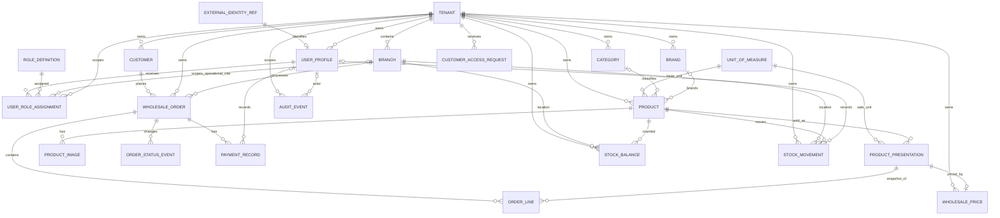

# Modelo de datos propuesto — Mayorista V1

> D-053 (2026-11-13): Ingreso y Consulta de Compras usan el mismo formulario y modelo. El contexto de navegación contiene solo controlador/estado del modal, nunca datos de tenant, costos o inventario. Ver [navegación y pruebas](PURCHASES_MODAL.md).

> D-052 (2026-11-13): La apertura modal real y rutas de Compras conservan el mismo PurchaseForm y todos los contratos de borrador/recepción; no se altera el modelo, integridad, inventario, idempotencia ni auditoría. Ver [prueba modal real](PURCHASES_MODAL.md).

> D-051 (2026-11-13): La presentación y optimización de Compras conservan el modelo y contratos actuales, Decimal y las restricciones de base. La estimación visual exacta no sustituye la validación ni el cálculo servidor. Ver [mediciones, verificaciones y límites](PURCHASES_PERFORMANCE.md).

> D-050 (2026-11-12): Los cinco campos opcionales de Purchase (`documentType`, `pointOfSale`, `documentNumber`, `purchaseCategory`, `taxAmount`) ya est?n desplegados en `milo_dev`. La octava migraci?n autorizada conserva columnas y datos anteriores, incorpora el CHECK validado y ajusta ?nicamente la funci?n de integridad para neto + IVA manual. No agrega entidades de N/C, deuda o pagos. Las notas anteriores de despliegue pendiente son hist?ricas. Ver [registro](DECISIONS.md#d-050--despliegue-autorizado-de-detalles-de-compras).

> D-049 (2026-11-12): Purchase incorpora documentType, pointOfSale, documentNumber, purchaseCategory y taxAmount opcionales en el esquema preparado; total sigue siendo final y suma IVA manual explícito cuando existe. Sin desglose, IVA permanece null y el cálculo V1 se conserva. Categoría de compra es texto propio del documento, independiente de Category. La octava migración se probó únicamente aislada; en milo_dev están aplicadas solo las siete anteriores. No existen entidades de N/C, deuda ni pagos; pantallas preparadas no implican modelo aprobado. Ver [contrato](PURCHASES_MODULE_RESTRUCTURE.md).

> D-048 (2026-11-12): se agregan PurchaseCounter por tenant, Purchase (CP000001, proveedor, sucursal, fecha, ARS, DRAFT/RECEIVED, versión, actores, referencia/observaciones y huellas de operación) y PurchaseLine (producto/unidad/SKU/nombre históricos, cantidad, costo y subtotal). StockMovement.purchaseLineId distingue compras de WholesaleOrder, con FK compuesta y una recepción por renglón. Cantidades enteras en unidad base, costos Decimal y proveedor histórico mínimo. Una compra incluso borrador bloquea eliminar su proveedor; FKs desconocidas siguen denegando. No hay pagos, saldos de proveedor ni precio de venta actualizado. Migración preparada y probada solo aislada; pendiente en la base real. Contrato: [PURCHASES_V1_PROPOSAL.md](PURCHASES_V1_PROPOSAL.md).

> D-047: el modelo no cambia. La exportación de Proveedores requiere que el cliente Prisma del proceso incluya Supplier/SupplierCounter; se comprueban delegados al reutilizar el singleton y se recargó Next.js para descartar metadatos antiguos.

> D-046: Excel/impresión no añade campos ni relaciones. Las altas importadas respetan Customer REGISTERED y su autorización separada, y los contratos actuales de Supplier. Estados/JSON existentes no se sobrescriben; lote y auditorías se guardan atómicamente en el modelo vigente. Contrato: [ADMIN_DATA_TRANSFER_PROPOSAL.md](ADMIN_DATA_TRANSFER_PROPOSAL.md).

> D-045: Supplier y SupplierCounter disponibles con clave tenant, nombres, CUIT/IVA opcionales, contacto, domicilio, observaciones y numeración empresarial. Migración autorizada y aplicada a milo_dev el 2026-11-11, sin cambios en datos previos. No hay relaciones de compras inventadas; futuras referencias compuestas/RESTRICT requieren revisión de borrado. Contrato: [SUPPLIERS_V1_PROPOSAL.md](SUPPLIERS_V1_PROPOSAL.md).

> D-044 (alcance corregido): [ADMIN_TABLES.md](ADMIN_TABLES.md) queda como referencia opcional de Clientes y Proveedores. El usuario retiró la obligación de repetir ese formato en otros listados actuales o futuros; no se modifican modelos, datos, permisos ni reglas comerciales.

> D-043 (2026-11-11): ampliación de Clientes aprobada e implementada. La migración 20261111043000_expand_customer_commercial_profile fue autorizada expresamente y aplicada mediante Prisma Migrate a 127.0.0.1:5432/milo_dev, tras respaldo externo verificable. Quedaron cinco migraciones aplicadas y ninguna pendiente; las huellas de los campos originales de todas las tablas coinciden y los nuevos campos son consultables. El esquema anterior conserva su fallback básico; la ampliación ya está habilitada en milo_dev. Ver [CUSTOMERS_V1_EXPANSION_PROPOSAL.md](CUSTOMERS_V1_EXPANSION_PROPOSAL.md).


> D-041: implementada la administración básica de Clientes con listado, búsqueda, paginación y modal compartido, solo OWNER/ADMIN COMPANY del tenant. Contacto v1 y alta REGISTERED sin autorización comercial; estados anteriores inalterados y JSON incompatible protegido. Concurrencia y auditoría transaccionales, sin cambios de esquema ni datos reales durante la tarea. Contrato aprobado: [CUSTOMERS_V1_PROPOSAL.md](CUSTOMERS_V1_PROPOSAL.md). Supera las referencias anteriores a Clientes sin implementar.

> D-040: Productos, Marcas y Categorías comparten el patrón de alta/edición modal y sus páginas directas, sin cambios de servicios, permisos, auditoría ni modelo. Clientes y Proveedores siguen sin alta/edición implementada. Contrato y alcance: [ADMIN_FORMS.md](ADMIN_FORMS.md).

> D-039: el plan de activación se suministra privadamente por variables MILO_ACTIVATION_*, sin datos personales ni identificadores reales en el código. Se conservan journals y evidencias fuera de Git; las referencias históricas a un plan fijo quedan superadas. No se ejecuta activación ni se modifican datos en esta preparación. Ver DECISIONS.md y scripts/activation/README.md.

> D-038: todos los campos monetarios actuales y futuros se presentan como `100.000,00`; los contratos internos conservan decimales exactos sin miles y con punto decimal, moneda explícita y los límites vigentes. Vacío y cero son distintos. La regla no modifica cantidades, factores, signos permitidos ni entidades: [MONEY_FORMAT.md](MONEY_FORMAT.md).

> D-034: ningún modelo ni restricción cambió durante el diagnóstico del ingreso fallido. El cliente en memoria desconocía los campos ya migrados; su caché ahora está ligada al constructor generado vigente. StockMovement.id continúa siendo la clave estable de idempotencia y no se generó ni reenvió un ingreso real. Ver DECISIONS.md.

> Estado D-033, 2026-11-10: reason/sourceReference y los dos CHECK manuales ya existen y están validados en milo_dev mediante la migración autorizada. Cuatro migraciones aplicadas, ninguna pendiente; datos y relaciones anteriores intactos. No se crearon movimientos ni se modificó el contrato del modelo durante la aplicación. Las referencias siguientes al esquema pendiente son históricas; detalles del respaldo y verificaciones en DECISIONS.md.

### Uso operativo de StockBalance/StockMovement (D-033)

Contrato manual aprobado: MANUAL_RECEIPT suma un delta positivo; MANUAL_ADJUSTMENT suma/resta según dirección explícita y exige motivo. Se agregan reason opcional VARCHAR(1000) y sourceReference opcional VARCHAR(200), con motivo obligatorio por CHECK para ajustes; nullable preserva historial anterior. SourceOrderId conserva su FK y no se usa como documento manual. Idempotencia reutiliza la PK UUID y compara payload/actor; no hay un modelo de documento o proveedor nuevo. Cantidades enteras en unidad base, Decimal exacto; sin fracciones/conversiones. Actor desde perfil/authUser y auditoría atómica sin PII adicional. Migración pendiente en milo_dev con bloqueo de escrituras; flujos reales probados en PostgreSQL aislado. Ver D-033.

### Lectura administrativa de indicadores (D-032)

Dashboard consulta únicamente conteos tenant-scoped de Customer y Product para OWNER/ADMIN COMPANY, sin interpretar Customer.status o confundir Product.isPublished con existencia. Ventas/Pedidos no tienen una métrica operativa definida y quedan sin cifras. Branch sigue sin un concepto persistido de sucursal activa: el encabezado informa alcance/asignación verificados, sin inferir selección. No cambian modelos ni relaciones. Ver D-032.

### Uso administrativo de Branch (D-031)

El panel permite alta/edición exclusivamente de Branch.name (obligatorio; límite técnico de formulario 200 caracteres). id, tenantId, createdAt y todas las relaciones se preservan; updatedAt es el token de concurrencia generado por servidor. El modelo no tiene dirección, contacto ni estado: no se agregan ni simulan esos campos. OWNER/ADMIN COMPANY, auditoría mínima por tenant/actor y sin eliminación o asignación de usuarios. Ver D-031; no cambia el modelo de datos.

### Flujo comercial simple sin cambios de modelo (D-030)

El alta habitual reutiliza UN/COUNT y guarda Product sin fracciones, ProductPresentation Individual habilitada con conversionFactor exacto 1 y WholesalePrice explícito cero o positivo. No se agrega concepto de presentación principal al modelo: en edición solo se reutiliza una candidata individual inequívoca y habilitada; si falta se crea únicamente al ingresar precio, sin alterar las otras. Configuraciones especiales, ambiguas o deshabilitadas quedan en avanzado; base, fraccionamiento e historial se preservan. Sin stock inicial, conversiones o redondeo. Auditoría transaccional y controles de versión en los tres registros. Ver D-030.

### Uso administrativo de Brand, ProductPresentation y WholesalePrice (D-029)

Brand admite alta y edición de nombre, sin unicidad inventada ni borrado. ProductPresentation admite nombre, unidad de la misma dimensión que Product, factor positivo explícito y habilitación. Unidad/dimensión/factor quedan protegidos si existen OrderLine; nunca se reasigna producto. WholesalePrice opcional se configura separadamente por presentación, sin precio cero por defecto, con moneda del Tenant. Factores/precios son strings exactos de hasta 3/2 decimales; se admiten precios cero o positivos por autorización expresa, distinguiendo cero de ausencia de precio. Negativos pendientes y bloqueados. No se interpretan fracciones ni se calculan conversiones/redondeos. OWNER/ADMIN COMPANY, aislamiento, versiones y auditoría atómica sin cambiar los modelos. Ver D-029; amplía D-027.

> D-028: el vocabulario inicial aprobado y cargado de UnitOfMeasure contiene `UN` (Unidad, COUNT) y `M` (Metro, LENGTH). Es compartido, sin tenantId. Solo se cargaron esas dos filas; no se crearon productos ni presentaciones y no se definieron conversiones, fracciones o redondeos. Las referencias a catálogo vacío son históricas.

### Uso administrativo del catálogo (D-027)

Category y Product tienen alta/edición tenant-scoped para OWNER/ADMIN COMPANY, sin modificación del modelo. Alta Product requiere unidad global existente y booleano de fracciones elegido explícitamente; la dimensión se resuelve desde UnitOfMeasure. No se implementan reglas operativas de fracciones, conversión o redondeo. En edición no se aceptan base/dimensión/fraccionamiento, precios ni cantidades. ProductPresentation y WholesalePrice son de lectura exacta mediante strings escala 3/2; no se generan presentaciones ni precios implícitos. Brand solo se selecciona entre filas existentes del tenant. Auditoría mínima de Category/Product en la transacción y cero operaciones de borrado; restricciones/triggers históricos intactos. Ver D-027 en DECISIONS.md.

### Uso inicial de Tenant y AuditEvent (D-026)

`/panel/empresa` permite a OWNER/ADMIN COMPANY editar exclusivamente commercialName opcional (vacío→NULL, límite técnico de formulario 200 caracteres). Dirección permanece en lectura por alcance/detalle pendiente; contactData se muestra como representación textual de solo lectura, sin contrato de campos públicos inventado. Moneda, locale, zona horaria y priceVisibility también son de lectura. No se modifican tipos ni nulabilidad de Prisma. AuditEvent registra solo tenant/actor/entidad/acción/fecha, con código TENANT_COMMERCIAL_NAME_UPDATED en la transacción del cambio; no se añaden snapshots, JSON ni política general de retención. Ver D-026 en DECISIONS.md.

> D-025, 2026-11-09: Milo Store y su primer OWNER responsable autorizado ya fueron creados y verificados con los IDs previstos, vínculo authUserId y alcance COMPANY sin sucursal. Cuenta credential gestionada por Better Auth, emailVerified=false y cero sesiones automáticas. Sin cambios de modelo ni datos comerciales adicionales; las referencias a alta pendiente son históricas.

### Preparación local de activación (D-024)

No cambia Prisma ni las migraciones. El [script local preparado](../scripts/activation/README.md) reserva identificadores estables y el plan autorizado suministrado de forma privada. Better Auth gestiona identidad y credencial; UserProfile se vincula exclusivamente por el ID retornado y verificado. OWNER conserva COMPANY con branchId=null. Sin sucursal, storefront, sesión automática, verificación ficticia de correo ni datos fiscales de relleno. En milo_dev solo se ejecutó dry-run de lectura; ninguna fila de activación fue creada. El rollback real pasó en las cuatro etapas sobre una base temporal autorizada, verificada vacía y eliminada.

> Estado actualizado D-023: `/acceso` ofrece ingreso real por correo/contraseña y `/panel` tiene estructura protegida empresarial. Solo se muestran cuenta, empresa y asignaciones reales autorizadas. Sin registro público, invitaciones, métricas ficticias ni módulos comerciales operativos. TenantStorefront permanece aplicado, sin integración editorial. Las referencias anteriores a ingreso informativo o login pendiente describen etapas previas.

> Estado público vigente (D-021): MILO es la plataforma de HenkoSoft. Sitio institucional multipágina en `/`; Milo Store en `/tiendas/milo-store`; `/acceso` solo informa el estado del ingreso. Sin nuevos módulos, pantallas privadas ni cambios de datos. Las referencias históricas a una única landing quedan reemplazadas por esta estructura.

## Estado y alcance

Este documento registra el modelo conceptual y su implementacion inicial en Prisma. La migracion init se genero en modo create-only y se aplicó previamente según confirmación del responsable; ver el estado actualizado al final.

La aplicación tiene sitio institucional multipágina de MILO y portal informativo de Milo Store, sin flujos comerciales. Init y add_better_auth se aplicaron y su estado fue verificado en etapas anteriores; esta tarea pública no vuelve a consultar ni modificar la base.

El módulo contempla empresas, usuarios, empleados, roles/sucursales, catálogo, precios, clientes, pedidos, registros manuales de pago e inventario. No incorpora entidades de módulos minoristas ni de reparaciones. La administración central de HenkoSoft no forma parte de este modelo de datos empresariales.

### Estado de las decisiones

- **Acordado:** Better Auth seleccionado para identidad, credenciales y sesiones; clientes pueden existir sin cuenta; autorización obligatoria en servidor; confirmar pedidos requiere al menos una línea; pedidos y movimientos se asocian a una sucursal; inventario por tenant/sucursal/producto exclusivamente en unidad base; un producto tiene unidad base y puede ofrecer múltiples presentaciones, cada una con unidad, factor de conversión, habilitación para nuevas ventas y precio mayorista propio; las líneas de pedido conservan snapshots de presentación, cantidad, factor, equivalente en unidad base, precio e importe; preservar historial comercial.
- **Implementado en el schema y preparado en `init`:** `DECIMAL(18,2)` para importes monetarios y `DECIMAL(18,3)` para cantidades y factores de conversión. La migración está auditada y se aplicó previamente según confirmación del responsable a `milo_dev`.
- **Pendiente de revisión:** vínculo opcional Customer-identidad y su ciclo de vida. StockMovement.sourceOrderId ya está modelado para trazabilidad, sin generar movimientos automáticos.
- **Pendiente:** flujo de autenticación, cardinalidad/uniquidad de vínculos de cliente, etiquetas/transiciones de estados, qué productos admiten fracciones y reglas de redondeo, catálogo global de unidades y sus códigos definitivos, protección definitiva de snapshots de pedido, cuándo un pedido genera un movimiento, estrategia de concurrencia y reintentos en los casos de uso, reglas de baja lógica y políticas/configuración RLS.
- **Implementado en Prisma:** modelos tenant-scoped, claves y relaciones compuestas, `UnitOfMeasure` compartido, unidad base por producto, presentaciones con equivalencia y estado, precio por presentación, snapshots ampliados y tipos decimales nativos explícitos. La propuesta `ExternalIdentityRef` se reemplazó por AuthUser y UserProfile.authUserId. RLS no está implementado. Los checks, índices únicos parciales y triggers adicionales están en la migración `init`, preparada y auditada y aplicada previamente según confirmación del responsable a la base principal.

## Convenciones de tipos

- Claves comerciales: `UUID`. IDs de Better Auth: `TEXT` opaco; authUserId usa ese mismo tipo.
- Importes y precios: `Decimal @db.Decimal(18, 2)` en Prisma; nunca `FLOAT`/`DOUBLE`.
- Cantidades y factores de conversión: `Decimal @db.Decimal(18, 3)` en Prisma. El indicador `Product.allowsFractionalQuantity` está modelado; su valor es explícito al crear el producto y la política de validación operativa queda pendiente.
- La precisión está declarada en el schema y en init, cuya aplicación previa fue confirmada por el responsable; `prisma generate` no altera la base.
- Fechas: `TIMESTAMPTZ`, persistidas en UTC.
- Texto: `TEXT` o `VARCHAR`; longitudes no fijadas mientras no exista una necesidad acordada.
- El prefijo `tenant_id` aparece en todo registro empresarial. La identidad/autenticación externa se mantiene separada y no sustituye el perfil tenant-scoped de la aplicación.

## Diagrama entidad-relación



`WholesaleOrder` es la entidad central del ciclo comercial V1. No se modela una entidad `Sale` separada. Un pedido puede prepararse sin líneas, pero no confirmarse sin al menos una. El diagrama muestra cardinalidad cero o más líneas durante la preparación; la validación de confirmación es distinta de la creación.

El vínculo opcional de `Customer` con una identidad externa no se dibuja como cardinalidad definitiva: se propone como dato opcional y su unicidad/cardinalidad debe resolverse antes del esquema.

## Entidades

### Tenant (empresa)

Representa a una empresa cliente de MILO SaaS. Es la raíz de propiedad y aislamiento para sus registros.

| Campo sugerido | Tipo PostgreSQL | Nota |
|---|---|---|
| `id` | `UUID` | PK. |
| `commercial_name` | `TEXT` | Nombre comercial. |
| `legal_name` | `TEXT` | Razón social. |
| `tax_id` | `TEXT` | CUIT; validación y obligatoriedad pendientes. |
| `fiscal_data` | `JSONB` o columnas tipadas | Estructura exacta pendiente; no agregar datos fiscales no aprobados. |
| `address` | `TEXT` | Alcance/detalle pendiente. |
| `contact_data` | `JSONB` o columnas tipadas | Campos exactos pendientes. |
| `logo_key` | `TEXT NULL` | Referencia al logo; almacenamiento y uso en documentos pendientes. |
| `currency` | `CHAR(3)` | Inicial `ARS`. |
| `locale` | `TEXT` | Inicial español. |
| `time_zone` | `TEXT` | Inicial `America/Argentina/Buenos_Aires`. |
| `account_status` | `TEXT`/enum | Estados y gestión pendiente. |
| `created_at`, `updated_at` | `TIMESTAMPTZ` | Trazabilidad temporal. |

Los campos de identidad empresarial están acordados en alcance; cuáles son obligatorios, su validación y políticas de retención no lo están.

### Identidad Better Auth

La propuesta conceptual ExternalIdentityRef se reemplaza por AuthUser. Better Auth 1.7.18 administra identidad, credenciales y sesiones en cuatro modelos globales, sin datos comerciales ni tenant_id:

| Modelo / tabla | Campos principales y relaciones |
|---|---|
| AuthUser / auth_users | id TEXT opaco, name, email globalmente único, emailVerified, image opcional, timestamps; relación inversa opcional a UserProfile. |
| AuthSession / auth_sessions | id, token único, expiresAt, userId FK a AuthUser, ipAddress/userAgent opcionales y timestamps. |
| AuthAccount / auth_accounts | id, accountId, providerId, userId FK a AuthUser, hash password y tokens/expiraciones opcionales, timestamps; unicidad providerId/accountId. |
| AuthVerification / auth_verifications | id, identifier indexado, value, expiresAt y timestamps. No habilita correo por sí solo. |

Los IDs de autenticación son TEXT generados por Better Auth; los IDs comerciales siguen siendo UUID. Sesiones y cuentas usan ON DELETE CASCADE hacia AuthUser. El vínculo desde UserProfile usa RESTRICT para proteger pertenencia e historial. No se usa Organization ni registro público; invitaciones y proveedor de correo pendientes. El esquema suma 25 modelos: 21 comerciales existentes y cuatro de autenticación; add_better_auth fue aplicada y verificada en una etapa anterior.

### UserProfile / empleado

Perfil de aplicación separado de la autenticación y vinculado opcionalmente a AuthUser por ID. Cada perfil pertenece a exactamente un tenant. El perfil tenant-scoped representa al usuario empleado; no se propone una entidad `Employee` duplicada hasta que se aprueben atributos laborales diferenciados.

| Campo sugerido | Tipo PostgreSQL | Nota |
|---|---|---|
| `id` | `UUID` | PK interna. |
| `tenant_id` | `UUID` | FK a `Tenant`; obligatorio. |
| `authUserId` | `TEXT NULL UNIQUE` | FK opcional a AuthUser.id con ON DELETE RESTRICT y ON UPDATE RESTRICT; nunca vincular por email. |
| `created_at`, `updated_at` | `TIMESTAMPTZ` | Trazabilidad. |

Nombre, email e identidad son administrados por Better Auth. La unicidad de authUserId impide que una identidad tenga más de un UserProfile y, por tanto, pertenezca como empleado a varias empresas. Una sesión sin perfil no concede acceso empresarial; un perfil tampoco concede acceso a precios privados ni compra. La autorización comercial de Customer es independiente y su vínculo con identidad sigue pendiente.

### Branch (sucursal)

Una empresa puede tener una o varias sucursales. La relación de usuario a sucursal se representa mediante las asignaciones de roles descritas a continuación. El modelo registra stock por producto y sucursal, sin una entidad independiente de depósito.

| Campo sugerido | Tipo PostgreSQL | Nota |
|---|---|---|
| `id` | `UUID` | PK. |
| `tenant_id` | `UUID` | FK a `Tenant`; obligatorio. |
| `name` | `TEXT` | Nombre; unicidad y campos de dirección pendientes. |
| `created_at`, `updated_at` | `TIMESTAMPTZ` | Trazabilidad. |

Debe exponerse una clave única `(tenant_id, id)` para las FKs compuestas tenant-aware.

### RoleDefinition y UserRoleAssignment

`RoleDefinition` representa el vocabulario de roles. `UserRoleAssignment` vincula perfil, rol y alcance. Los códigos aprobados para MILO V1 son `OWNER` (Dueño), `ADMIN` (Administrador), `MANAGER` (Encargado), `SALES` (Vendedor), `TECHNICIAN` (Técnico) y `WAREHOUSE` (Depósito).

`RoleDefinition` sería un catálogo común del producto, sin `tenant_id` ni matriz de permisos. Toda autorización se comprueba obligatoriamente en el servidor en cada operación; la matriz detallada de permisos por rol se define en una etapa posterior.

| RoleDefinition: campo sugerido | Tipo PostgreSQL | Nota |
|---|---|---|
| `id` | `UUID` | PK. |
| `code` | `TEXT` | Código estable y único del rol. |
| `name` | `TEXT` | Etiqueta del rol. |
| `assignment_scope` | `TEXT`/enum | `COMPANY` para Dueño/Administrador; `BRANCH` para roles operativos. No representa permisos. |

| Campo sugerido | Tipo PostgreSQL | Nota |
|---|---|---|
| `id` | `UUID` | PK; se podría usar PK compuesta si se aprueba. |
| `tenant_id` | `UUID` | FK a `Tenant`; obligatorio. |
| `user_profile_id` | `UUID` | Usuario de la misma empresa. |
| `role_id` | `UUID` | FK a `RoleDefinition`; sin matriz de permisos por acción. |
| `assignment_scope` | `TEXT`/enum | Copia restringida del alcance de `RoleDefinition`, para validar por FK y `CHECK`. |
| `branch_id` | `UUID NULL` | Nulo para Dueño/Administrador; obligatorio para un rol operativo asignado por sucursal. |
| `created_at` | `TIMESTAMPTZ` | Registro de asignación. |

`RoleDefinition` tiene clave única `(id, assignmentScope)` y la asignación referencia ambos campos para que el alcance coincida con la definición. Los seis códigos técnicos aprobados para MILO V1 son `OWNER`, `ADMIN`, `MANAGER`, `SALES`, `TECHNICIAN` y `WAREHOUSE`: los dos primeros tienen alcance `COMPANY`; los cuatro restantes, `BRANCH`. El SQL de `init` incorpora un `CHECK` que limita estos códigos a sus alcances. Otro `CHECK` exige `branchId IS NULL` para `COMPANY` y no nulo para `BRANCH`. Las FKs compuestas impiden asignar un usuario o una sucursal de otro tenant. Un empleado puede tener varios roles, sujeto a los índices únicos parciales documentados abajo.

### Product, Category, Brand y ProductImage

Todos son propiedad de un tenant.

| Entidad/campos principales | Tipos sugeridos y reglas |
|---|---|
| `Product`: `id`, `tenant_id`, `sku`, `name`, `description`, `base_unit_code`, `base_unit_dimension_code`, `allows_fractional_quantity`, `category_id`, `brand_id`, `is_published`, timestamps | UUIDs; la unidad base referencia el catálogo global `UnitOfMeasure`; `allows_fractional_quantity` es booleano sin valor por defecto implícito. El inventario se controla únicamente en unidad base. Categoría/marca son FKs tenant-aware; publicación `BOOLEAN`. SKU único dentro del tenant. |
| `UnitOfMeasure`: `code`, `name`, `dimension_code` | Catálogo estándar compartido, sin `tenant_id`; `code` identifica la unidad y `dimension_code` permite comprobar compatibilidad entre unidad base y unidad de presentación. No se fija ni se carga aquí un listado definitivo. Las empresas no definen unidades personalizadas en este modelo V1. |
| `Category`: `id`, `tenant_id`, `name`, timestamps | UUID, nombre de texto; solo clasificación aprobada, sin jerarquía anticipada. |
| `Brand`: `id`, `tenant_id`, `name`, timestamps | UUID y nombre de texto. |
| `ProductImage`: `id`, `tenant_id`, `product_id`, `storage_key`, timestamps | Referencia opaca al objeto. Metadatos, límites y ciclo de vida de imágenes requieren definición existente antes de implementar. |
| `ProductPresentation`: `id`, `tenant_id`, `product_id`, `name`, `unit_code`, `dimension_code`, `conversion_factor`, `is_enabled`, timestamps | Cada fila representa una presentación de venta del producto. `unit_code` referencia el catálogo compartido y `dimension_code` debe coincidir con el de la unidad base. El factor convierte la cantidad vendida a cantidad equivalente base. La presentación se habilita/deshabilita explícitamente; no se elimina si tiene historial. No se permite cambiar unidad/equivalencia cuando ya está referenciada por líneas históricas; el trigger SQL queda pendiente. |

No se incluyen aquí campos de código de barras, compatibilidad u otros atributos no aprobados en el alcance vigente.

Ejemplos conceptuales: presentación «unidad» con factor 1; «caja de 10 unidades» con factor 10 respecto de una unidad base individual; presentación «metro» con factor 1 para producto cuya unidad base es metro; y «rollo de 100 metros» con factor 100 respecto de esa unidad base. Son ejemplos, no un catálogo de unidades cargado ni una lista cerrada.

### WholesalePrice (renglón de la lista general)

La decisión vigente contempla una sola lista general por tenant. Cada `WholesalePrice` es el precio de una presentación de venta dentro de esa lista general; las presentaciones de un mismo producto pueden tener precios independientes. No se justifica una tabla `PriceList` mientras no se acuerden varias listas.

| Campo sugerido | Tipo PostgreSQL | Nota |
|---|---|---|
| `id` | `UUID` | PK. |
| `tenant_id` | `UUID` | FK a `Tenant`. |
| `product_presentation_id` | `UUID` | FK compuesta a la presentación del mismo tenant; única por tenant y presentación. |
| `amount` | `NUMERIC(18,2)` | En Prisma, `Decimal @db.Decimal(18, 2)`. Nunca usar coma flotante binaria. |
| `updated_at` | `TIMESTAMPTZ` | Última modificación; historial de precios no está definido. |

La moneda del precio es la moneda del tenant (`Tenant.currency`); no se duplica en cada renglón de la única lista. La lista tiene como máximo un precio por presentación; la regla operativa ante una presentación sin precio queda pendiente.

El acceso a esta entidad es privado: el servidor solo entrega precio a clientes mayoristas autorizados y activos. No se incluye un precio/costo en la proyección pública del producto.

### Customer y CustomerAccessRequest

`Customer` es un comprador mayorista de una empresa tenant, no una empresa SaaS. Puede existir y ser administrado/operado en los registros comerciales sin cuenta de usuario. Su vínculo con una identidad externa es opcional. La solicitud de acceso se modela separada del registro de cliente, para conservar la regla de que solicitar no crea acceso.

| Entidad/campos principales | Tipos sugeridos y reglas |
|---|---|
| `Customer`: `id`, `tenant_id`, datos de contacto aprobados, estado, timestamps | D-041: contactData JSONB v1 con schemaVersion=1, name obligatorio y email/phone/address opcionales. Alta REGISTERED sin autorización comercial; estado previo inalterado al editar. JSON incompatible protegido. Sin cambios de esquema, unicidad inferida ni vínculo Customer-identidad. Puede operar sin UserProfile ni cuenta autenticable. Estados comerciales adicionales pendientes. |
| `CustomerAccessRequest`: `id`, `tenant_id`, datos recibidos, estado de revisión, `reviewed_by_user_id NULL`, `reviewed_at NULL`, timestamps | La aprobación es manual. Campos/formato y ciclo de vida, canal y relación resultante con `Customer` quedan pendientes. Si se persisten datos personales, aplicar mínimo acceso y política de retención pendiente. |

La relación entre solicitud aprobada y `Customer` debe definirse para evitar duplicar contacto. Cómo se autoriza a un cliente sin cuenta a consultar precios o pedidos online queda pendiente; no se asume que la existencia del registro de cliente le otorgue acceso autenticado.

### WholesaleOrder y OrderLine

`WholesaleOrder` es la entidad central del ciclo comercial V1 y representa un pedido realizado por un cliente mayorista autorizado y activo. Cada pedido se asocia obligatoriamente con la sucursal que lo procesa. `OrderLine` conserva snapshots de SKU, nombre, presentación, unidad, cantidad pedida, factor de conversión, cantidad equivalente en unidad base, precio e importe para que cambios futuros del catálogo o de la presentación no alteren el historial comercial.

| Entidad/campos principales | Tipos sugeridos y reglas |
|---|---|
| `WholesaleOrder`: `id`, `tenant_id`, `branch_id`, `customer_id`, `status`, `currency`, `total`, `created_at`, `updated_at` | UUID, FKs tenant-aware y `branch_id NOT NULL`; estado comercial separado del pago; moneda e importe total quedan como snapshot del pedido. `total NUMERIC(18,2)` (`Decimal @db.Decimal(18, 2)`). Origen y campos de entrega/contacto pendientes. |
| `OrderLine`: `id`, `tenant_id`, `order_id`, `product_presentation_id`, `sku_snapshot`, `name_snapshot`, `presentation_name_snapshot`, `unit_snapshot`, `quantity_snapshot`, `conversion_factor_snapshot`, `base_quantity_snapshot`, `unit_price_snapshot`, `line_total` | FK tenant-aware obligatoria a presentación. Snapshots de presentación/unidad, cantidad, factor, cantidad equivalente en unidad base, precio e importe, además de SKU/nombre. Cantidades/factor `NUMERIC(18,3)` e importes `NUMERIC(18,2)`. La moneda se hereda del pedido. La FK `RESTRICT` conserva la presentación histórica; los casos de uso normales no modifican snapshots. |
| `OrderStatusEvent`: `id`, `tenant_id`, `order_id`, `actor_user_id NULL`, `previous_status`, `new_status`, `occurred_at` | Historial de cambios con actor y fecha; catálogo de estados, motivos y transiciones válidas pendientes. |

Importes y estados se determinan en servidor, no a partir de valores confiados del navegador. El pedido conserva la sucursal que lo procesa.

#### Flujo inicial del pedido y estados

El ciclo comercial distingue la preparación del pedido de su confirmación. Al confirmar, se valida que exista al menos una `OrderLine`; un pedido todavía en preparación no necesita cumplir esa condición. Después de confirmar, la empresa administra el pedido y registra transiciones en `OrderStatusEvent`.

No hay nombres ni conjunto de estados comerciales acordados en el alcance. No se fija un enum ni se inventan estados; nombres, transiciones válidas, cancelación y actor autorizado quedan pendientes antes de definir el catálogo final.

Los estados del pedido y los estados del pago son independientes. Ningún cambio de estado comercial implica por sí mismo un movimiento de stock. Los movimientos mantienen su tipo propio (entrada, salida o ajuste) y su trazabilidad independiente.

### PaymentRecord (registro manual de pago)

Aunque no se contempla procesamiento automático, el alcance mayorista vigente sí incluye registro y confirmación manual de transferencia y efectivo asociado a un pedido.

| Campo sugerido | Tipo PostgreSQL | Nota |
|---|---|---|
| `id` | `UUID` | PK. |
| `tenant_id`, `order_id` | `UUID` | FKs tenant-aware. |
| `method` | `TEXT`/enum | `TRANSFER` o `CASH`, según los medios acordados. |
| `status` | `TEXT`/enum | Estado de pago separado del estado del pedido; valores y transiciones pendientes. |
| `amount` | `NUMERIC(18,2)` | `Decimal @db.Decimal(18, 2)` en Prisma; importe exacto, nunca Float. |
| `currency` | `CHAR(3)` | ARS inicial. |
| `reference` | `TEXT NULL` | Referencia disponible, si corresponde; formato no fijado. |
| `recorded_by_user_id` | `UUID` | Actor que registra. |
| `confirmed_by_user_id NULL`, `confirmed_at NULL` | `UUID`, `TIMESTAMPTZ` | Confirmación manual y actor/fecha. |
| `created_at` | `TIMESTAMPTZ` | Trazabilidad. |

No es una pasarela ni una integración externa. Reglas detalladas de captura, múltiples registros, reversión o asociación tardía no están definidas aquí.

### Inventario: StockBalance y StockMovement

`StockMovement` es el registro persistente de entradas, salidas y ajustes. `StockBalance` guarda el saldo operativo actual para consultar y aplicar la prohibición de saldo negativo. Ambos almacenan cantidades exclusivamente en la unidad base del producto. El movimiento es la trazabilidad; el saldo debe mantenerse transaccionalmente coherente con los movimientos, sin edición directa.

| Entidad/campos principales | Tipos sugeridos y reglas |
|---|---|
| `StockBalance`: `tenant_id`, `branch_id`, `product_id`, `quantity_on_hand`, `updated_at` | PK compuesta `(tenant_id, branch_id, product_id)` identifica inequívocamente saldo por producto y sucursal. FKs consistentes. Cantidad en unidad base `NUMERIC(18,3)` / `Decimal @db.Decimal(18, 3)`; saldo no negativo. |
| `StockMovement`: `id`, `tenant_id`, `branch_id`, `product_id`, `movement_type`, `quantity_delta`, `reason NULL`, `sourceReference NULL`, `source_order_id NULL`, `actor_user_id`, `occurred_at` | Cada movimiento registra sucursal y producto del mismo tenant; cantidad en unidad base `NUMERIC(18,3)`. D-033 define ingresos manuales positivos y ajustes con delta firmado y motivo obligatorio. Salidas por ventas/pedidos y otras reglas siguen pendientes. Los dos campos de trazabilidad requieren la migración nueva aún no aplicada a milo_dev. |

El stock se registra por producto y sucursal; no se crea una entidad independiente de depósito. El vínculo `source_order_id` es trazabilidad cuando el movimiento corresponda a un pedido; no define cuándo, quién ni bajo qué estado se genera. Confirmar un pedido no crea automáticamente movimientos ni reservas. La asociación de un movimiento a una línea/producto del pedido queda pendiente.

Si una operación de pedido da lugar a cambios de inventario, el movimiento asociado expresa cantidad en unidad base; el vínculo no aprueba por sí solo automatismos ni define cuándo se modifica stock. Cada actualización de `StockBalance` y su `StockMovement` correspondiente se realiza transaccionalmente. Debe protegerse frente a escrituras concurrentes que pudieran producir stock negativo. La técnica concreta (por ejemplo, bloqueo o actualización condicional) se valida antes de Prisma; el saldo no se edita de forma aislada.

### Ventas y ciclo comercial

Para V1, `WholesaleOrder` es la entidad central del ciclo comercial. No se crea una tabla `Sale` independiente. Los cambios de estado quedan trazados en `OrderStatusEvent`; sus valores y transiciones siguen pendientes.

### AuditEvent (auditoría mínima)

Registro de acciones sensibles sobre datos del tenant, sin convertirse en bitácora detallada de todos los eventos de negocio.

| Campo sugerido | Tipo PostgreSQL | Nota |
|---|---|---|
| `id` | `UUID` | PK. |
| `tenant_id` | `UUID` | FK al tenant cuando el evento trata datos empresariales. |
| `actor_user_id NULL` | `UUID` | Actor tenant-scoped; eventos sin usuario requieren caso definido. |
| `action` | `TEXT` | Código descriptivo; catálogo pendiente. |
| `entity_type`, `entity_id` | `TEXT`, `UUID` | Referencia lógica al objeto; no sustituye FKs de negocio. |
| `occurred_at` | `TIMESTAMPTZ` | Fecha del evento. |

Datos a registrar, retención, inclusión de valores anteriores/nuevos y tratamiento de operaciones centrales de HenkoSoft quedan pendientes. La administración central no se mezcla con roles ni datos empresariales.

## Relaciones, cardinalidades y claves

Todas las entidades con `id` indicado usan ese UUID como PK sugerida, salvo `StockBalance`, que usa la PK compuesta indicada. Cuando una FK tenant-aware referencia un registro empresarial, la tabla padre debe tener una clave candidata `UNIQUE (tenant_id, id)` para validar la pareja tenant/ID. Esto incluye `UserProfile`, requerido por las FKs de asignaciones y actores. `Tenant` y los catálogos globales se referencian por su PK global.

| Entidad | FKs principales sugeridas |
|---|---|
| `Tenant` | Ninguna. |
| `AuthUser`, `AuthSession`, `AuthAccount`, `AuthVerification` | Identidad, sesiones y credenciales administradas por Better Auth; globales, sin permisos comerciales; ver D-020. |
| `UserProfile` | `tenantId → Tenant.id`; `authUserId → AuthUser.id` opcional y único, con ON DELETE RESTRICT. |
| `RoleDefinition` | Catálogo común de roles, independiente del perfil y sin FK tenant; `(id, assignment_scope)` es clave candidata. |
| `Branch` | `tenant_id → Tenant.id`. |
| `UserRoleAssignment` | `tenant_id → Tenant.id`; `(tenant_id, user_profile_id) → UserProfile`; `(role_id, assignment_scope) → RoleDefinition`; `(tenant_id, branch_id) → Branch` cuando `branch_id` no sea nulo. |
| `Product`, `Category`, `Brand` | `tenant_id → Tenant.id`; en `Product`, `(tenant_id, category_id) → Category` y `(tenant_id, brand_id) → Brand` cuando estén informados. |
| `ProductImage` | `tenant_id → Tenant.id`; `(tenant_id, product_id) → Product`. |
| `UnitOfMeasure` | Catálogo global compartido, sin `tenant_id`; `(code, dimension_code)` es clave candidata para referencias que comprueban la dimensión. |
| `Product` | `tenant_id → Tenant.id`; `(tenant_id, category_id) → Category`, `(tenant_id, brand_id) → Brand`; `(base_unit_code, base_unit_dimension_code) → UnitOfMeasure`. |
| `ProductPresentation` | `tenant_id → Tenant.id`; `(tenant_id, product_id, dimension_code) → Product(tenant_id, id, base_unit_dimension_code)`; `(unit_code, dimension_code) → UnitOfMeasure(code, dimension_code)`. Las dos FKs compuestas exigen que presentación y unidad base compartan dimensión. |
| `WholesalePrice` | `tenant_id → Tenant.id`; `(tenant_id, product_presentation_id) → ProductPresentation`. |
| `Customer`, `CustomerAccessRequest` | `tenant_id → Tenant.id`; vínculo Customer-identidad pendiente; en solicitudes, `(tenant_id, reviewed_by_user_id) → UserProfile` cuando haya revisor. Relación solicitud-cliente pendiente. |
| `WholesaleOrder` | `tenant_id → Tenant.id`; `(tenant_id, branch_id) → Branch`; `(tenant_id, customer_id) → Customer`; clave candidata `(tenant_id, branch_id, id)` para movimientos relacionados. |
| `OrderLine` | `tenant_id → Tenant.id`; `(tenant_id, order_id) → WholesaleOrder`; `(tenant_id, product_presentation_id) → ProductPresentation`, obligatoria y `RESTRICT`. El producto se alcanza mediante la presentación. |
| `OrderStatusEvent` | `tenant_id → Tenant.id`; `(tenant_id, order_id) → WholesaleOrder`; `(tenant_id, actor_user_id) → UserProfile` cuando haya actor. |
| `PaymentRecord` | `tenant_id → Tenant.id`; `(tenant_id, order_id) → WholesaleOrder`; FKs tenant-aware a usuarios que registren/confirmen. |
| `StockBalance`, `StockMovement` | `tenant_id → Tenant.id`; `(tenant_id, branch_id) → Branch`; `(tenant_id, product_id) → Product`; FK tenant-aware a actor en movimiento; `StockMovement.(tenant_id, branch_id, source_order_id) → WholesaleOrder.(tenant_id, branch_id, id)` si `source_order_id` no es nulo. |
| `AuditEvent` | `tenant_id → Tenant.id` y actor tenant-aware cuando el evento sea empresarial. |

- `Tenant 1:N` sucursales, usuarios, productos, categorías, marcas, clientes, solicitudes, presentaciones, precios, pedidos, inventario y eventos de auditoría. `UnitOfMeasure` es global y compartido.
- `UserProfile 1:N` asignaciones de rol; `Branch 1:N` asignaciones operativas. Dueño/Administrador tienen alcance general dentro del tenant, sin depender de pertenencia a otra empresa.
- `Category 1:N Product`, `Brand 1:N Product`, `Product 1:N ProductImage` y `Product 1:N ProductPresentation`; obligatoriedad de categoría/marca en producto pendiente.
- `ProductPresentation 0:1 WholesalePrice` en la única lista general; unicidad tenant/presentación. Un producto puede tener varias presentaciones, cada una con precio propio.
- `Customer 1:N WholesaleOrder`; `WholesaleOrder 1:N OrderStatusEvent/PaymentRecord` y `0:N OrderLine` mientras se prepara. Para confirmar, debe existir al menos una línea.
- `Branch 1:N StockBalance/StockMovement`; cada saldo y movimiento se asocia a una sucursal. `Product 1:N StockBalance/StockMovement`, con cantidades exclusivamente en la unidad base y sin referencia a presentación para el inventario.
- `ProductPresentation 0:N OrderLine`; cada línea referencia una presentación y registra snapshots que conservan los datos usados en el pedido.
- `WholesaleOrder` es la única entidad central del ciclo comercial V1; no hay entidad `Sale` separada. Pedido comercial, pago y movimiento de stock conservan estados/registros independientes.
- PK recomendadas son UUID. Deben existir claves únicas `(tenant_id, id)` en padres para que las FKs compuestas validen el tenant en las relaciones. Los nombres finales y PK compuestas vs. simples requieren elección al definir el esquema Prisma.

## Restricciones e índices sugeridos

Las siguientes expresan integridad del modelo; donde dependen de una decisión pendiente, se indican como condicionales.

### Restricciones

- `UserProfile.tenant_id NOT NULL`; si se persiste referencia externa local, `external_identity_id UNIQUE` para que una identidad no se asocie a perfiles de más de una empresa.
- AuthUser.email globalmente único; UserProfile.authUserId opcional y único. Las credenciales se administran exclusivamente por Better Auth.
- FKs tenant-aware para cualquier relación entre datos empresariales: incluir `(tenant_id, referenced_id)` hacia una clave única equivalente del registro padre.
- `UNIQUE (tenant_id, sku)` en `Product`.
- `UNIQUE (tenant_id, id)` en `ProductPresentation` como destino tenant-aware y `UNIQUE (tenant_id, product_presentation_id)` en `WholesalePrice`, con un precio por presentación en la lista general.
- `StockBalance.quantityOnHand >= 0` mediante `CHECK` SQL obligatorio.
- Asignaciones de rol únicas por tenant/usuario/rol/sucursal efectiva, mediante los dos índices únicos parciales especificados en “SQL obligatorio para la primera migración”.
- FK `(roleId, assignmentScope)` coincidente con `RoleDefinition`; los checks relacionan `assignmentScope` con `branchId` y restringen los códigos de rol por alcance. La semántica y los seis identificadores técnicos están aprobados para MILO V1.
- `WholesaleOrder.branch_id NOT NULL` con FK compuesta `(tenant_id, branch_id)`.
- PK de `StockBalance` es `(tenant_id, branch_id, product_id)`; FKs compuestas garantizan la misma empresa.
- `StockMovement` requiere `tenant_id`, `branch_id` y `product_id`, con FKs compuestas a sucursal y producto.
- `WholesaleOrder` debe tener `UNIQUE (tenant_id, branch_id, id)` para la FK opcional de un movimiento asociado a un pedido de la misma sucursal.
- Si `StockMovement.source_order_id` está informado, FK `(tenant_id, branch_id, source_order_id)` al pedido de la misma empresa y sucursal. No implica generación automática de movimientos.
- Confirmar un pedido requiere al menos una línea. Validar en la operación de confirmación; el mecanismo final de integridad se define antes de Prisma.
- Los estados deben usar valores controlados, pero el catálogo de estados y transiciones de solicitudes, pedidos y pagos queda pendiente de aprobación.
- No permitir actualización directa del saldo sin movimiento asociado; el mecanismo transaccional y permisos finales se definen antes de implementar.
- No usar `ON DELETE CASCADE` desde tenant, pedido, producto, sucursal, cliente o usuario hacia pedidos, líneas, pagos, eventos o movimientos históricos; preferir `RESTRICT`/`NO ACTION` u otra acción no-cascade equivalente.
- Preservar pedidos, pagos y movimientos históricos. Para productos, clientes, usuarios y sucursales que ya no deban operar, preferir una baja lógica/inactivación cuando corresponda; campo, estados y reglas aún requieren definición.
- No borrar físicamente pedidos, líneas históricas, pagos, eventos de estado ni movimientos de stock. El procedimiento para corregir un registro erróneo queda pendiente.
- No borrar físicamente un tenant con registros comerciales sin política aprobada. Retención y cierre de empresa pendientes.

### Índices

- Todos los hijos tenant-scoped: índice sobre `tenant_id` o índice compuesto cuyo prefijo permita la consulta por tenant.
- `AuthUser`: email único; `AuthSession`: token único e índice userId; `AuthAccount`: providerId/accountId único e índice userId; `AuthVerification`: índice identifier.
- `UserProfile`: `UNIQUE (tenant_id, id)` para FKs tenant-aware y `UNIQUE (external_identity_id)` si se adopta el vínculo local. PostgreSQL permite múltiples NULL en un índice único ordinario; la obligatoriedad del vínculo queda pendiente.
- `Branch`, `Product`, `Category`, `Brand`, `Customer`, `CustomerAccessRequest` y `WholesaleOrder`: clave candidata `UNIQUE (tenant_id, id)`. `StockBalance` usa su PK compuesta de tenant/sucursal/producto.
- `RoleDefinition`: `UNIQUE (code)` y `UNIQUE (id, assignment_scope)` para la FK compuesta de asignaciones.
- `RoleDefinition`: `CHECK` que obliga a Dueño/Administrador a alcance `COMPANY` y a Encargado/Vendedor/Técnico/Depósito a alcance `BRANCH`; los seis códigos SQL aprobados se detallan en la sección SQL obligatorio para la primera migración.
- `Product`: `UNIQUE (tenant_id, sku)` e índices tenant-scoped por categoría, marca y publicación para consultas previstas del catálogo. La estrategia de búsqueda básica queda pendiente; no se propone búsqueda de texto avanzada.
- `UnitOfMeasure`: catálogo compartido sin tenant; clave `code` y clave candidata `(code, dimension_code)`.
- `Product`: FK a unidad base compartida; `UNIQUE (tenant_id, id, base_unit_dimension_code)` como destino tenant-aware de presentaciones.
- `ProductPresentation`: `UNIQUE (tenant_id, id)` y FK compuesta a `Product` que fija tenant y dimensión base; FK compuesta a `UnitOfMeasure` que obliga a coincidir en dimensión. Estas FKs están representadas en Prisma.
- `WholesalePrice`: `UNIQUE (tenant_id, product_presentation_id)` y FK compuesta a `ProductPresentation`.
- `UserRoleAssignment`: índice `(tenant_id, user_profile_id)` y `(tenant_id, branch_id, role_id)` para autorización; los índices únicos parciales obligatorios están especificados más abajo.
- `Customer`: `(tenant_id, status)`; no se declara email/teléfono único mientras no se acuerde normalización y política de duplicados.
- `WholesaleOrder`: `(tenant_id, branch_id, customer_id, created_at)` y `(tenant_id, branch_id, status, created_at)` para consultas por sucursal.
- `WholesaleOrder`: clave adicional `(tenant_id, branch_id, id)` para el vínculo de movimientos asociados.
- `OrderLine`: `(tenant_id, order_id)` y FK tenant-aware obligatoria a `ProductPresentation`.
- `ProductImage`: `(tenant_id, product_id)` para recuperar imágenes del producto dentro del tenant.
- `CustomerAccessRequest`: `(tenant_id, status, created_at)` para revisión manual, sujeto a confirmar las pantallas/consultas.
- `OrderStatusEvent` y `PaymentRecord`: `(tenant_id, order_id, occurred_at/created_at)` o equivalente para historial del pedido.
- `StockBalance`: PK/índice único `(tenant_id, branch_id, product_id)`; `StockMovement`: `(tenant_id, branch_id, product_id, occurred_at)`.
- `StockMovement`: `(tenant_id, branch_id, source_order_id)` cuando se utilice el vínculo a pedido.
- `AuditEvent`: `(tenant_id, occurred_at)`.

Los índices destinados a consultas condicionadas a pantallas aún no aprobadas deben confirmarse con esas consultas; no crean una funcionalidad nueva por sí solos.

## Estado de implementación Prisma y restricciones SQL pendientes

La versión actual de `prisma/schema.prisma` contiene `UnitOfMeasure`, `ProductPresentation`, unidad base y condición de cantidades fraccionarias en `Product`, precio por presentación y snapshots ampliados en `OrderLine`. Los importes usan `Decimal @db.Decimal(18, 2)`; cantidades y conversiones usan `Decimal @db.Decimal(18, 3)`. No incluye `ExternalIdentityRef`; usa `AuthUser` y `UserProfile.authUserId` según D-020. Los estados permanecen como `String`; los estados comerciales siguen sin enums; PriceVisibility sí es un enum. Init y add_better_auth fueron aplicadas y verificadas en etapas anteriores; no se consulta PostgreSQL en esta tarea pública.

Para no inventar los detalles de contacto y de solicitudes, `Customer.contactData` y `CustomerAccessRequest.submittedData` son `JSONB` sin una estructura interna acordada. `Tenant.fiscalData` y `Tenant.contactData` también usan `JSONB` opcional como representación provisional de los campos aún no detallados. Los atributos comerciales del tenant se dejaron opcionales porque su obligatoriedad sigue pendiente. Revisar esos contenedores y nulabilidades antes de una migración de producción.

El esquema declara las relaciones y claves tenant-aware, las claves únicas necesarias como destino de FKs compuestas y acciones `RESTRICT` para proteger el historial. `StockMovement.sourceOrderId` se mantiene opcional y no provoca movimientos ni reservas automáticas.

El schema Prisma no declara directamente los `CHECK` ni los índices únicos parciales siguientes. Están incorporados como SQL adicional en `prisma/migrations/20261108225754_init/migration.sql`; forman parte de la migración preparada, con aplicación previa informada para `milo_dev`. Los nombres de tablas usan `@@map`; las columnas mantienen los nombres camelCase del schema.

```sql
ALTER TABLE "role_definitions"
ADD CONSTRAINT "role_definitions_scope_by_code_check"
CHECK (
  ("assignmentScope" = 'COMPANY' AND "code" IN ('OWNER', 'ADMIN'))
  OR
  ("assignmentScope" = 'BRANCH' AND "code" IN ('MANAGER', 'SALES', 'TECHNICIAN', 'WAREHOUSE'))
);

ALTER TABLE "user_role_assignments"
ADD CONSTRAINT "user_role_assignments_scope_branch_check"
CHECK (
  ("assignmentScope" = 'COMPANY' AND "branchId" IS NULL)
  OR
  ("assignmentScope" = 'BRANCH' AND "branchId" IS NOT NULL)
);

ALTER TABLE "stock_balances"
ADD CONSTRAINT "stock_balances_quantity_nonnegative_check"
CHECK ("quantityOnHand" >= 0);

ALTER TABLE "product_presentations"
ADD CONSTRAINT "product_presentations_conversion_factor_positive_check"
CHECK ("conversionFactor" > 0);

ALTER TABLE "order_lines"
ADD CONSTRAINT "order_lines_quantities_positive_check"
CHECK (
  "quantitySnapshot" > 0
  AND "conversionFactorSnapshot" > 0
  AND "baseQuantitySnapshot" > 0
);

CREATE UNIQUE INDEX "user_role_assignments_company_role_unique"
ON "user_role_assignments" ("tenantId", "userProfileId", "roleId")
WHERE "branchId" IS NULL;

CREATE UNIQUE INDEX "user_role_assignments_branch_role_unique"
ON "user_role_assignments" ("tenantId", "userProfileId", "roleId", "branchId")
WHERE "branchId" IS NOT NULL;
```

La asignación `COMPANY` corresponde únicamente a `OWNER` y `ADMIN`; `BRANCH`, a `MANAGER`, `SALES`, `TECHNICIAN` y `WAREHOUSE`. Los seis códigos están aprobados y el `CHECK` que impone esa correspondencia está incluido en `init`.

La actualización de `StockBalance` y la inserción de su `StockMovement` correspondiente deben ejecutarse dentro de una misma transacción. `init` incorpora bloqueos de fila para coordinar escrituras de inventario y un `CHECK` como última barrera contra saldos negativos. Los futuros casos de uso deben bloquear todas las filas padre necesarias en orden `(tenantId, id)` antes de leer unidades/factores o guardar cantidades/snapshots; como puede haber deadlocks, deben contemplar reintentos. La consistencia entre el saldo agregado y el ledger no puede garantizarse con un `CHECK` de una sola fila.

Las FKs compuestas desde `ProductPresentation` a `Product` y `UnitOfMeasure` comparten `dimensionCode`; así exigen que la unidad comercial tenga la misma dimensión que la unidad base. El catálogo global no lleva `tenant_id`, por lo que no admite unidades particulares por empresa. `Product.allowsFractionalQuantity` registra la configuración, pero el alcance exacto de su aplicación a cantidad de presentación/base y su validación transaccional requieren definirse antes de los casos de uso.

La migración `init` incluye triggers SQL para impedir cambiar `productId`, `unitCode`, `dimensionCode` o `conversionFactor` de una presentación mientras alguna `OrderLine` la referencia, y para impedir cambiar `Product.baseUnitCode`/`baseUnitDimensionCode` cuando existan saldos o movimientos del producto. También incluye triggers de bloqueo coordinado para escrituras de líneas, saldos y movimientos. Estas reglas están en el archivo de migración, pero no están instaladas en `milo_dev` hasta que se aplique.

Los casos de uso normales del servidor no deben modificar snapshots históricos de `OrderLine` (SKU, nombre, presentación, unidad, cantidad, factor, equivalente base, precio e importe). La protección de aplicación es obligatoria. Un trigger que permita editar líneas durante preparación pero congele las confirmadas depende de los estados comerciales aún pendientes; no puede definirse correctamente hasta acordar esas etiquetas/transiciones.

- Confirmación de `WholesaleOrder` solo si tiene al menos una línea: debe comprobarse en la transacción del caso de uso. Un trigger SQL sería necesario solo si se exige imponer la regla frente a escrituras que eviten la aplicación.
- RLS y sus políticas no están implementadas.

Los `CHECK`, índices parciales y triggers anteriores están incorporados en la migración inicial `init`, preparada y auditada y aplicada previamente según confirmación del responsable a `milo_dev`. La aplicación previa fue informada por el responsable; no se volvió a verificar contra PostgreSQL en esta sesión.

## Aislamiento multi-tenant

1. Cada registro empresarial contiene `tenant_id` como FK a `Tenant`. Las entidades globales de plataforma, si se modelan en otra etapa, se excluyen expresamente y no forman parte de este modelo mayorista.
2. Cada usuario tiene exactamente un `UserProfile` tenant-scoped y una sola pertenencia a empresa. No se modelan usuarios que seleccionan o alternan tenant.
3. El servidor resuelve usuario, empresa, rol y sucursal efectiva a partir de contexto autenticado y datos de base. Nunca confía en `tenant_id`, `branch_id`, rol o permiso enviado por navegador.
4. La autorización se aplica obligatoriamente en el servidor para cada operación. Cada lectura y escritura comercial verifica tenant; los roles operativos verifican además la sucursal asignada. Dueño/Administrador tienen alcance general solo dentro de su empresa. La matriz detallada de permisos queda para una etapa posterior.
5. Cada pedido y cada movimiento/saldo de stock se vincula a una sucursal de su tenant. Las FKs compuestas tenant-aware impiden referencias a empresa, usuario, producto, cliente o sucursal de otro tenant.
6. IDs no predecibles y filtros de Next.js/UI no son aislamiento suficiente. PostgreSQL Row Level Security (RLS) es defensa adicional; su diseño y configuración quedan pendientes para la implementación PostgreSQL. RLS no sustituye autorización obligatoria en servidor en cada operación.
7. HenkoSoft central es un ámbito separado y no una asignación de rol de tenant. No concede acceso de usuario a datos comerciales de otra empresa.
8. Prisma se usa solo en servidor. Si la conexión del ORM puede omitir RLS, la autorización server-side de la aplicación sigue siendo obligatoria.

## Decisiones que requieren aprobación antes del esquema definitivo

1. Completar el flujo de invitaciones de OWNER/ADMIN, proveedor de correo y ciclo de vida del vínculo Customer-identidad. Better Auth ya está seleccionado; las credenciales se administran exclusivamente mediante Better Auth.
2. Campos de empleado, customer y solicitud de acceso; cardinalidad/uniquidad y efecto del vínculo opcional cliente-identidad externa; canal de solicitud y ciclo de aprobación.
3. Campos obligatorios del tenant, CUIT/datos fiscales, contacto, dirección, logo y estado de cuenta.
4. Permisos específicos por acción y nomenclatura final de roles, manteniendo las reglas de alcance y restricciones indicadas.
5. Detalles de campos/estados del pedido y relación entre la salida de inventario y el pedido. Cada pedido sí queda asociado a su sucursal de procesamiento.
6. Políticas y campos de baja lógica, retención y cierre del tenant. Deben preservarse pedidos, pagos y movimientos históricos.
7. Obligatoriedad de categoría/marca, políticas de baja de producto y campos de fotos.
8. Alcance de `allowsFractionalQuantity` en la cantidad de presentación y/o en unidad base, y reglas de redondeo para la multiplicación cantidad × factor.
9. Códigos/nombres definitivos de las unidades que poblarán el catálogo global `UnitOfMeasure`; no hay lista inicial ni unidades tenant-defined en el schema.
10. Protección definitiva de los snapshots históricos de `OrderLine` según el ciclo de vida que se apruebe. Los triggers de `init` protegen la identidad de presentaciones referenciadas y la unidad base frente a saldos/movimientos; no congelan ni impiden borrar líneas.
9. Etiquetas/transiciones de solicitud, cliente, pedido y pago; el flujo estructural distingue preparación/confirmación y exige una línea al confirmar. Referencias y multiplicidad de registros manuales de pago.
10. Cuándo un pedido confirmado produce un movimiento de inventario y si el vínculo se expresa por pedido o por línea; sin automatismos no aprobados.
11. Consultas que ofrecerán clientes y empleados, y por tanto índices de pedidos, precios e inventario.
12. Estrategia concreta de actualización transaccional/concurrente que evite saldos negativos.
13. Snapshot de los datos de contacto del cliente en el pedido y campos que comprendería.
14. Estrategia de integridad y consulta para `AuditEvent` polimórfico: `entityType`/`entityId` no constituyen una FK hacia una tabla concreta.
15. Si se adopta `.env`, cómo cargarlo desde `prisma.config.ts`; actualmente la variable debe estar disponible en el entorno del proceso.
16. Campos, alcance y retención de `AuditEvent`; políticas RLS concretas/configuración PostgreSQL, rol de conexión Prisma y mapeo de restricciones/índices parciales en Prisma.

La resolucion de estos puntos no debe ampliar el alcance funcional descrito en `WHOLESALE_V1_SCOPE.md`. Verificar el historial real de migraciones antes de aplicar nuevas migraciones y definir los pendientes correspondientes antes de desarrollar casos de uso comerciales.


## Estado de preparacion de la migracion inicial

Los seis códigos técnicos de rol (`OWNER`, `ADMIN`, `MANAGER`, `SALES`, `TECHNICIAN`, `WAREHOUSE`) y sus alcances están aprobados para MILO V1 e incorporados en el SQL de `init`. La migración está preparada y auditada y se aplicó previamente según confirmación del responsable a `milo_dev`.


## PriceVisibility y vinculacion futura de identidad de cliente

El modelo Prisma incorpora el enum `PriceVisibility` con `PUBLIC` y `AUTHENTICATED_CUSTOMERS`. `Tenant.priceVisibility` es no nulo y tiene default `AUTHENTICATED_CUSTOMERS`, que se aplica al crear nuevos registros. La migración no crea ni inicializa el tenant Milo Store; su configuración inicial deberá establecerse durante la inicialización de datos. No se agrega una bandera para ocultar el catálogo completo. `Product.isPublished` sigue siendo por producto.

CustomerAccessRequest representa una solicitud, no una identidad ni una autorizacion. UserProfile representa a un empleado y no concede acceso comercial. Antes de autenticacion/precios privados se necesita una entidad futura CustomerIdentity con tenantId, customerId, issuer y subject externos, FK compuesta a Customer y unicidad tenant/issuer/subject. El proveedor es Better Auth; el diseño y ciclo del vínculo Customer-identidad siguen pendientes. Las credenciales pertenecen exclusivamente a Better Auth y no a modelos comerciales.

La autorizacion privada requiere en servidor identidad autenticada, tenant efectivo y Customer vinculado cuyo estado comercial indique aprobado y activo. Los codigos/estados exactos siguen pendientes. La autorizacion de compra se evalua aparte; la visibilidad PUBLIC no concede capacidad de comprar.


## Protocolo de bloqueo e historial append-only

La migracion init usa bloqueos de fila PostgreSQL como mecanismo comun. El UPDATE de ProductPresentation o Product ya tiene bloqueada su fila antes de evaluar el trigger. Los triggers de INSERT/actualizacion de OrderLine bloquean las filas ProductPresentation referenciadas con SELECT FOR UPDATE y orden (tenantId,id). Los INSERT/actualizaciones de StockBalance y los INSERT de StockMovement bloquean Product con SELECT FOR UPDATE. Luego el trigger del padre consulta las filas historicas dentro de la transaccion. El lock del padre y el de las escrituras dependientes serializan las dos operaciones.

Las operaciones de aplicación deben adquirir los bloqueos de todas las filas padre necesarias en orden estable `(tenantId, id)` antes de leer unidad/factor y antes de calcular o guardar cantidades/snapshots. Las operaciones que tocan varios productos o presentaciones deben bloquear el conjunto completo en una transacción. Los triggers por fila no sustituyen este protocolo para operaciones multi-entidad; aun siguiendo el orden previsto pueden producirse deadlocks, por lo que la aplicación deberá contemplar reintentos de deadlock/serialización.

ProductPresentation.productId, unitCode, dimensionCode y conversionFactor no se pueden cambiar mientras OrderLine la referencie; nombre e isEnabled pueden cambiar. Product.baseUnitCode/baseUnitDimensionCode no se pueden cambiar cuando haya saldos o movimientos. StockMovement bloquea UPDATE, DELETE y TRUNCATE. Un movimiento correctivo requiere una decision futura; no se introduce aqui una regla de reverso.

`OrderLine` sigue pudiendo modificarse o eliminarse: no se definieron estados para separar preparación de historia cerrada y la migración no congela sus snapshots. La protección definitiva del historial de pedidos es requisito previo a habilitar operaciones comerciales históricas. Hasta definir el ciclo de vida, no se debe introducir un trigger condicionado a estados inventados.


### Storefront editorial reutilizable (D-021, fases 2 y 3)

El portal /tiendas/milo-store ahora se sirve mediante app/(comercial)/tiendas/[slug], con plantilla mayorista y componentes comerciales reutilizables. Solo existe la entrada editorial milo-store; no corresponde a una creación, carga o consulta de Tenant. Personalización visual acotada al storefront y panel con identidad global de MILO. No cambian el esquema, los permisos, el alcance mayorista ni el acceso comercial.

## TenantStorefront — preparación de persistencia editorial (D-022)

Estado: modelo y migración aditiva `20261109150000_add_tenant_storefront` aplicados a PostgreSQL local, sin conectar el portal a Prisma. Esta preparación posterior a D-021 no migra el registro editorial existente ni crea datos.

| Campo | Representación y contrato |
| --- | --- |
| `tenantId` | UUID, PK y FK a `Tenant.id`, sin generación de un UUID independiente. Cada storefront pertenece obligatoriamente a un tenant; un Tenant tiene cero o un storefront (`Tenant.storefront?`). FK con RESTRICT en borrado y actualización, siguiendo las convenciones comerciales existentes. |
| `slug` | VARCHAR(63), obligatorio, único global. ASCII minúsculas/dígitos separados por guiones simples: `^[a-z0-9]+(-[a-z0-9]+)*$`, de 1 a 63 caracteres. Sin espacios, mayúsculas, acentos, guiones consecutivos ni extremos. CHECK con collation C; no se normaliza silenciosamente. |
| `template` | Enum `StorefrontTemplate`, único valor y default `WHOLESALE`. No habilita otros módulos. |
| `registrationPolicy` | Enum `StorefrontRegistrationPolicy`, único valor y default `MANUAL`. No habilita autorregistro, identidad, precios ni compra. |
| `draft` | JSONB obligatorio de tipo objeto, sin default: el futuro escritor deberá proporcionar explícitamente un documento versionado. |
| `published` | JSONB opcional de tipo objeto. SQL NULL indica ausencia de publicación; JSON `null`, arrays y escalares se rechazan. |
| `publishedAt` | TIMESTAMPTZ(6) opcional; debe existir si y solo si existe `published`. |
| `revision` | INTEGER obligatorio, default 1 y CHECK > 0; token de concurrencia de toda la fila, independiente de la versión del formato JSON. |
| `createdAt` / `updatedAt` | TIMESTAMPTZ(6), `now()` / `@updatedAt`, según la convención Prisma existente. `@updatedAt` se mantiene desde Prisma, no mediante un trigger SQL. |

### Contrato previsto de configuración y versionado JSONB

El formato previsto v1 de cada documento es un objeto con `schemaVersion: 1` y los bloques editoriales `identity`, `contact`, `seo`, `theme` y `content`. La referencia de forma y nombres internos es el contrato TypeScript actual `lib/storefront/types.ts` (`StorefrontConfig`): identidad/logo públicos, contacto comercial, metadatos SEO, tokens visuales acotados y textos/secciones de la plantilla mayorista. Se excluyen `slug` y `template` del JSON porque ya tienen columnas tipadas; `registrationPolicy` tampoco se duplica en el documento. El valor persistido WHOLESALE requerirá una adaptación explícita al identificador `wholesale` de la plantilla actual cuando se implemente su lectura.

Este es un contrato previsto, no un parser ni una migración de contenido. Los CHECK solo validan el tipo objeto, no exigen schemaVersion ni los bloques internos: `{}` pasa el CHECK pero no es una configuración publicable conforme al contrato previsto. Antes de aceptar configuración externa se deberá implementar validación Zod estricta server-side por schemaVersion y plantilla, para edición y publicación. Deben definirse límites de textos/listas, URLs y referencias de assets permitidas, validación de tokens y tratamiento de claves desconocidas; no se inventan esas reglas en esta etapa. No almacenar HTML/CSS/JavaScript arbitrario, credenciales, sesiones, datos fiscales, clientes, inventario, permisos, precios privados ni controles comerciales en estos documentos editoriales públicos.

`schemaVersion` identifica el formato del JSON; `revision` identifica cambios concurrentes de la fila. Una evolución incompatible del formato debe tener otra versión y un conversor/validador explícito antes de usarla. Las versiones desconocidas no se publicarán ni se interpretarán como la última versión. Borrador y snapshot publicado se validan de forma independiente; una conversión del borrador no modifica silenciosamente el publicado. La estrategia concreta de compatibilidad y conversión queda pendiente para esa etapa. No hay backfill ni conversores implementados.

### Reglas previstas de edición, publicación y concurrencia

OWNER y ADMIN del mismo tenant podrán editar y publicar. La autorización efectiva, la resolución server-side de tenant/membresía y los casos de uso se implementarán después; ninguna columna o JSON enviado por el navegador otorga esos permisos. La administración central tampoco obtiene acceso editorial a otras empresas.

Guardar un borrador no publica. La futura acción manual de publicación deberá validar el borrador completo y guardar una copia en `published` junto con `publishedAt` en una única operación atómica. Editar después el borrador conservará el snapshot y la fecha publicados. La futura lectura pública solo consumirá el snapshot publicado validado, nunca el borrador; el comportamiento ante ausencia de publicación se definirá antes de conectar las rutas. El portal actual continúa con su registro editorial y no consume esta tabla.

Para controlar concurrencia, cada edición/publicación futura comparará en servidor `(tenantId, revision esperada)` e incrementará revision en la misma escritura/transacción. Si no actualiza una fila, deberá tratarlo como conflicto sin sobrescribir cambios ajenos. La publicación debe copiar la revisión del borrador efectivamente validada, sin leer y publicar una versión obsoleta. El CHECK positivo no incrementa revision ni implementa este protocolo; no se agregan triggers, endpoints o servicios de publicación.

La pareja `published`/`publishedAt` solo describe el snapshot vigente; no es un historial de versiones. No se implementan publicación programada, despublicación, rollback ni políticas de renombrado/reserva de slug. `slug`, `template` y `registrationPolicy` quedan fuera de los snapshots: su eventual modificación y efecto sobre una tienda publicada requieren una decisión antes de habilitar su edición. No se promete publicación diferida de esas columnas. `Tenant.priceVisibility` y la autorización de compra permanecen separadas e intactas.

### D-022 — Aplicación controlada verificada

El 2026-11-09 se confirmó la conexión a `127.0.0.1:5432/milo_dev` (PostgreSQL 17.11), las dos migraciones anteriores completas con checksums coincidentes y una única pendiente. Por autorización expresa se añadió BEGIN/COMMIT con lock_timeout=10s y statement_timeout=60s a la migración pendiente, conservando su DDL y cinco CHECK. Prisma 7.10.1 ejecutó únicamente add_tenant_storefront mediante migrate deploy.

Respaldo completo: evidencia local no versionada (84.775 bytes); pg_dump -Fc 17.11, pg_restore --list (191 entradas) y lectura completa sin restaurar, todos correctos. SHA-256: `d07f4fd25762bd24e0c7c8ef3cedbaf2e94532b405907922d1bec7c2c17d90a8`. Evidencia técnica en archivos .audit.json y .verified.json del mismo nombre base fuera del repositorio.

Verificados tabla vacía, dos enums, PK/índice único de slug, FK RESTRICT y cinco CHECK validados. Historial anterior intacto y huellas de esquema/datos de las 25 tablas previas coincidentes, incluidas las cuatro tablas Better Auth. migrate status al día, prisma validate correcto y diff real/schema vacío. Sin crear usuarios, tenants ni datos comerciales ni modificar .env, Docker o Better Auth. La edición/publicación de storefront y su autorización efectiva siguen pendientes.

## Ingreso y panel empresarial (D-023)

Implementado por autorización expresa: formulario real en /acceso mediante el cliente de Better Auth existente y cierre de sesión. La configuración y el handler Better Auth permanecen intactos, incluido disableSignUp=true; no hay registro público, OAuth, invitaciones ni recuperación de contraseña. Validación de formulario con Zod y validación independiente en servidor mediante Better Auth. Errores de credenciales genéricos, sin revelar existencia de cuenta ni propagar detalles del proveedor. Destinos de navegación fijos y del mismo origen.

El guard server-only reutilizable `lib/panel/access.ts` verifica sesión vigente en Better Auth sin cookie cache ni refresh desde RSC, resuelve UserProfile exclusivamente por authUserId y exige tenant existente/coherente. Consulta asignaciones por tenantId y userProfileId del servidor. OWNER/ADMIN conservan alcance COMPANY; MANAGER/SALES/TECHNICIAN/WAREHOUSE, BRANCH con sucursal de la misma empresa. Roles desconocidos, relaciones inconsistentes y errores de servicio deniegan acceso. Sin sesión redirige a /acceso; sin perfil/tenant muestra una negativa genérica y permite cerrar sesión. No usa email, encabezados o parámetros enviados por el navegador para determinar pertenencia.

El layout y la página /panel ejecutan el guard; React cache solo deduplica el render de una petición, sin caché compartida entre usuarios. Cada futura página, acción o endpoint protegido deberá invocarlo de nuevo y autorizar su operación. Esta primera pantalla solo admite consultar la propia cuenta, empresa y asignaciones; un perfil válido sin roles ve su cuenta y la ausencia de asignaciones, sin adquirir permisos operativos. No se infieren estados de Tenant.accountStatus, cuya semántica sigue pendiente. No se entregan tokens, credenciales ni datos fiscales, clientes, precios o inventario al shell del panel.

Sidebar responsive y topbar con identidad global MILO en azul, negro, gris y plateado. La personalización del tenant no modifica el panel. /acceso y /panel se renderizan dinámicamente y quedan fuera de indexación; el cierre invalida la sesión con Better Auth y realiza navegación completa para descartar el árbol privado del router. Solo cambió la página pública de acceso; el resto de páginas públicas, storefront, Prisma, migraciones y .env se preservan.

Verificación: 18 pruebas automatizadas con fixtures solo en memoria, incluido ingreso/cookie/cierre y registro bloqueado en el handler real, además de accesos permitidos/denegados del guard para seis roles, múltiples sucursales y cruces de tenant. Lint, typecheck y build con BETTER_AUTH_URL HTTPS temporal de proceso correctos. Comprobaciones HTTP de producción aislada sin PostgreSQL: /acceso 200, /panel anónimo o con identidad/rol/cookie falsificados redirige a /acceso, siete rutas públicas 200, tienda desconocida 404, registro bloqueado y correo malformado rechazado. Cache-Control del acceso: private/no-store. No se crearon usuarios, tenants ni sesiones reales. La comprobación visual en navegador no estuvo disponible por falta del host de automatización; no se probó un ingreso con credenciales reales.
